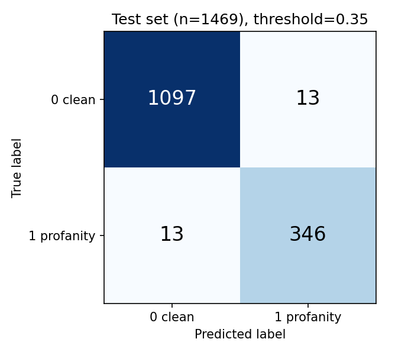

# Kazakh Profanity Detection

KBTU · DSSC5113 · Bonus project (Fall 2026, instructor Aidyn Abirov)
Student: **`<FULL NAME>`**, ID **`<STUDENT ID>`**

A binary text classifier for **one Kazakh product review or comment**:

| output | meaning |
|---|---|
| **0** | no Kazakh profanity |
| **1** | Kazakh profanity present |

Each prediction also shows the **probability of class 1**, for example:

```
$ python src/predict.py "Телефон бір аптада бұзылды, қотақбас сатушы"
1 = PROFANITY   P(profanity) = 0.998  (threshold 0.345)  | Телефон бір аптада бұзылды, қотақбас сатушы
```

The model is **TF-IDF over character n-grams + logistic regression**, trained by me on
9,865 labeled Kazakh reviews built from the public KazSAnDRA dataset.

---

## 1. Results at a glance (held-out test set, evaluated once)

| metric (class 1 = profanity) | value |
|---|---|
| test examples | **1,469** (359 profane, 1,110 clean) |
| precision | **0.964** |
| recall | **0.964** |
| F1 | **0.964** |
| accuracy (both classes) | 0.982 |
| decision threshold (chosen on validation) | 0.345 |



| | predicted 0 | predicted 1 |
|---|---|---|
| **true 0 (clean)** | 1097 (TN) | 13 (FP) |
| **true 1 (profanity)** | 13 (FN) | 346 (TP) |

All numbers come from `results/test_metrics.json`, produced by `python src/evaluate.py`.

---

## 2. Repository structure

```
config.yaml                    all settings: seed, sampling sizes, split ratios, model grid, paths
requirements.txt               pinned package versions
run_all.sh                     whole pipeline in one command
src/
  download_data.py   step 0    download KazSAnDRA from the authors' GitHub
  labeling_rules.py            rules used ONLY to build labels (the model never sees them)
  prepare_data.py    step 1    clean, deduplicate, label, group near-duplicates, split
  text_utils.py                clean_text() used for training AND prediction
  train.py           step 2    grid search on validation, threshold, save model
  evaluate.py        step 3    single test evaluation, confusion matrix, errors
  predict.py         step 4    predict on your own text with the saved model
  explain.py                   traces one comment from raw text to prediction
data/
  processed/dataset.csv        final labeled dataset (text, label, split, ...)
  labels/manual_labels.csv     every manual labeling decision with a short reason
  synthetic/synthetic.csv      60 hand-written synthetic examples (train only)
models/
  profanity_model.joblib       trained pipeline = TF-IDF vocabulary + IDF + LR weights (1.2 MB)
  model_info.json              chosen settings, threshold, validation scores, versions
results/
  test_metrics.json  confusion_matrix.png  test_predictions.csv  test_errors.csv
  validation_search.csv  top_ngrams.txt  data_stats.json
docs/DEFENSE_RU.md             defense preparation guide (in Russian)
```

---

## 3. Setup and quick start (no retraining needed)

```bash
git clone <this-repo-url>
cd kazakh-profanity-detection
python3 -m venv .venv && source .venv/bin/activate      # Windows: .venv\Scripts\activate
pip install -r requirements.txt
```

The trained model is in the repository (`models/`, 1.2 MB), so prediction works immediately:

```bash
python src/predict.py "Тауар керемет, тез жеткізді, рахмет!"     # one or more comments
python src/predict.py                                           # interactive mode, empty line = exit
python src/explain.py "Шаңсорғыш екі күнде сынды, қотақбас дүкен" # step-by-step explanation
```

From Python / a notebook cell:

```python
import sys; sys.path.insert(0, "src")
from predict import load_model, predict
model, threshold = load_model()
predict(["Курьер кешікті, бірақ тауар жақсы"], model, threshold)   # -> [(label, probability)]
```

## 4. Reproduce everything (training is ~10 s on a laptop CPU)

Run all commands from the repository root:

```bash
python src/download_data.py   # ~9 MB from github.com/IS2AI/KazSAnDRA, no login needed
python src/prepare_data.py    # -> data/processed/dataset.csv, results/data_stats.json
python src/train.py           # -> models/*, results/validation_search.csv, results/top_ngrams.txt
python src/evaluate.py        # -> results/test_metrics.json, confusion_matrix.png, test_errors.csv
```

or simply `bash run_all.sh`. All randomness uses `seed: 42` from `config.yaml`
(negative sampling, split, logistic regression), so the run is deterministic. A from-scratch run in a
fresh virtual environment with `requirements.txt` reproduced the identical `dataset.csv`, confusion
matrix and list of errors; probabilities differed only in the 6th decimal (different numpy/BLAS builds).

---

## 5. Dataset

### 5.1 Source and access

* **KazSAnDRA** – *Kazakh Sentiment Analysis Dataset of Reviews and Attitudes*
  (Yeshpanov & Varol, LREC-COLING 2024, [arXiv:2403.19335](https://arxiv.org/abs/2403.19335)),
  license **CC BY 4.0**. 175,158 Kazakh reviews with a 1–5 star rating from four domains:
  `appstore` (Google Play app reviews, 132k), `market` (product reviews from an online marketplace, 29k),
  `mapping` (reviews of places, 8k), `bookstore` (5k).
* Access: `src/download_data.py` downloads the *score classification* files
  `06_sc_train_ib.zip`, `09_sc_valid.zip`, `10_sc_test.zip` from
  <https://github.com/IS2AI/KazSAnDRA/tree/main/dataset> (public, no account needed; the same data is
  also on Hugging Face as the gated dataset `issai/kazsandra`). The authors' own train/valid/test split is
  **not** used.
* **Relation to product reviews:** KazSAnDRA is exactly the kind of text the task describes – short
  Kazakh customer reviews of goods (marketplace), apps and services, often mixed with Russian and written
  without Kazakh letters. Real profanity appears almost only in the app-store reviews (the marketplace
  moderates its reviews), see *Limitations*.
* KazSAnDRA's labels are **sentiment ratings, not profanity labels**, so they were *not* used as targets.
  The rating is used only to sample many **1–2 star (angry) but clean** reviews as negatives, because a
  negative review is not automatically profane.

### 5.2 Labeling method

KazSAnDRA has no profanity labels, so I built them in three stages
(see `src/labeling_rules.py`, `data/labels/manual_labels.csv`):

1. **Rule tagging of all 167,750 unique reviews.** Every review gets a tag:
   `strict` (unambiguous obscene stem, e.g. *қотақ-, сік-/сгин, ам-ы/ың, жалап, ташақ, шешеңнің амы*,
   Russian *бля, хуй, пизд-, еба-, сука, заебал*), `review` (may be obscene: bare *ам*, *көт*,
   masked words, …), `insult` (rude but not obscene: *мал, ақымақ, оңбаған, лох, шошқа, есек, блин*)
   or `none`.
2. **Manual review** of every `review`-tagged comment (414) – each decision and its reason is saved.
3. **Manual check of the whole test split** (1,469 comments): the rule label was confirmed or
   corrected. 17 rule labels were wrong (1.2 %): 6 false alarms of the rules (e.g. *«ұсын амын»* =
   «ұсынамын») and 11 misses (abbreviations *зб, длб*, `#`-masking *«сі#ейын»*, spelling
   *«далбоиоп»*). The same rule gaps were then searched for in train/val and fixed (13 comments).
   So the **test labels are fully human-checked**, while about 1 % label noise probably remains in
   train/val (rule-only labels).

The rules are only a labeling tool: **the classifier never sees them**, it learns from the labeled text.

### 5.3 Labeling rules (what counts as Kazakh profanity)

| case | rule |
|---|---|
| obscene Kazakh words (қотақ, сік-, ам-, жалап, ташақ …) and obscene phrases (*шешеңнің амы, аузын сігейін*) | **1** |
| Russian mat used inside a Kazakh comment (бля, хуй, пиздец, сука, заебал, далбаеб …) | **1** – code-switching is normal in Kazakh comments and a moderator would remove it |
| masked words where the obscene word is recognisable (*с**а, н***, қ*тақбас, бл**, сі#ейын*) | **1** |
| abbreviations of mat (*зб* = заебал, *длб* = далбаеб) | **1** |
| any spelling: Latin script (*kotakbas*), missing Kazakh letters (*котак*), repeated letters (*сукаааа*) | same label as the normal spelling |
| vulgar body word *көт* (ass), Russian *жопа*, used as an insult or crude expression | **1** |
| *көт-* as a literal word in a baby-care review, or typos of *көп / күту / көтеру* | **0** |
| negative review, complaint, anger, bad rating without obscene words | **0** |
| insults that are not obscene: *мал, ақымақ, оңбаған, есек, шошқа, лох, чмо, дебил* | **0** |
| euphemisms and clipped curses: *блин, далбаса, далбан, шешен!* (without an obscene word) | **0** |
| asterisks used as decoration (`*рахмет*`) or as stars (`*****`) | **0** |
| sexual words that are not obscene (*секс, порно*) | **0** |
| ambiguous case with a plausible obscene reading | **1**, decision noted in `manual_labels.csv` |
| comment containing a person's full name or address | **removed** (14 comments) |

The language of the comment does not change the rule: comments are Kazakh, Russian-Kazakh mixed,
or Kazakh in Latin script; pure Kyrgyz or pure Russian texts are rare in KazSAnDRA and were kept.

### 5.4 Labeled examples (real KazSAnDRA comments from the dataset)

| text | label | why |
|---|---|---|
| Миллион доллар с\*\*а | 1 | masked Russian mat (с\*\*а = сука) |
| Кірмейт, н\*\*\* керек емес | 1 | masked word |
| Котакбас шшс | 1 | spelling variant котак = қотақ |
| Kotakbas onwa emes otirik | 1 | Latin script |
| Пиздец күшті ойын екег | 1 | positive sentiment, still profane |
| Каспи бля тиын алгам … пенясы өсіп кетті | 1 | Russian mat inside a Kazakh comment |
| Орындықтардың сапасы нашар, столдың беті дұрыс қойлмаған, жалпы сапасы онша емес. | 0 | negative product review, no profanity |
| Тупой жынды ақымақ | 0 | insult (ақымақ = fool) but not obscene |
| Мал ойын екен бұл ойынды тарпаңдар | 0 | insult *мал* but not obscene |
| Жұқа, иісі жоқ, баланың көтені дем алатын подгузниктердің бірі … | 0 | *көт* as a literal word (diaper review) |
| Бұл ойында скин жоқ | 0 | *скин* = game skin, not *сік-* |
| \*Қазақшаны Қалай Құсамыз?\* | 0 | asterisks used as formatting |

### 5.5 Synthetic examples

60 short reviews in marketplace style were **written by hand** (with AI assistance) and are stored in
`data/synthetic/synthetic.csv`, marked `is_synthetic = 1` in `dataset.csv`:
30 profane (product-review context, Latin script, masking, digits like *қ0тақбас*) and
30 hard negatives (*скидка, аман, амал, көтеру, шешем, Hyundai, блендер, сигнал*, negative but clean
reviews). They are used **only in training**; validation and test contain only real comments.

### 5.6 Building the dataset (`src/prepare_data.py`)

1. Remove personal data with regexes: links → `<url>`, e-mails → `<email>`, phone numbers → `<phone>`,
   `@mentions` → `<user>`. KazSAnDRA has no author names; 14 comments that mention a person's full name
   were removed by hand.
2. **Exact duplicates removed** (key = letters only, lower-case, repeated letters collapsed):
   175,158 → 167,750.
3. Pool: all `strict` + `review` + `insult` comments, plus a seeded random sample of 6,000 `none`
   comments (app store 4,000 – half of them 1–2 star reviews –, market 1,500, mapping 300, bookstore 200).
4. **Near-duplicates** (cosine similarity ≥ 0.80 of character 3–5-gram TF-IDF vectors) are joined into
   groups with union-find; **a whole group always goes to one split** (42 groups with ≥ 2 comments).
   `prepare_data.py` asserts this.
5. Groups are shuffled with seed 42 and split 70 / 15 / 15, stratified by "is a profanity candidate";
   groups containing synthetic examples go to train.

### 5.7 Size and class distribution

| split | total | class 0 | class 1 | share of class 1 |
|---|---|---|---|---|
| train | 6,925 (incl. 60 synthetic) | 5,239 | 1,686 | 24.3 % |
| validation | 1,471 | 1,103 | 368 | 25.0 % |
| test | 1,469 | 1,110 | 359 | 24.4 % |
| **total** | **9,865** | **7,452** | **2,413** | 24.5 % |

Label sources: rules `strict` 1,850 · rules `none` 5,093 · rules `insult` 1,036 · manual 1,826 ·
synthetic 60. Random seed: **42**.
Note: 24.5 % profanity is much more than in real life (~1.5 % of all KazSAnDRA reviews hit the
profanity rules) because all candidate comments were kept on purpose.

---

## 6. Model

### 6.1 Why TF-IDF character n-grams + logistic regression

* **Profanity is mostly a matter of word forms**, not of long-range meaning. The same root appears in
  dozens of spellings (*қотақ / котак / kotak / қ\*тақ / қотаққа / қотақбастар*); character n-grams
  share pieces like `отак`, `қот`, `тақ` across all of them, so the model generalises to spellings it
  never saw.
* Small data (≈7k training comments) – a linear model with ~27k features trains in seconds, does not
  overfit badly, and needs no GPU.
* It is **fully explainable** at the defense: the prediction is a weighted sum of n-gram scores
  (`src/explain.py`, `results/top_ngrams.txt`).
* It gives a probability (`predict_proba`) that can be shown next to the label.

A fine-tuned multilingual transformer would likely understand context better (see Limitations) but is
heavier and harder to explain; the spec allows one model.

### 6.2 How text becomes model input

1. `clean_text()` (fixed rules, nothing learned): personal-data placeholders, lower-case, `ё → е`,
   letters repeated 3+ times → 2 (*сукаааа → сукаа*), whitespace collapsed, cut to the first 1,000 characters.
2. **Tokenization = character n-grams** with `analyzer="char_wb"`: each word is padded with spaces and cut
   into all 1-, 2-, 3- and 4-character pieces, e.g. `" қотақ "` → `" қ", "қо", "от", …, " қот", "қота", "отақ", "тақ "`.
3. **TF-IDF**: each n-gram gets weight `(1 + log tf) × idf`; the vector is L2-normalised.
   Vocabulary and IDF are **fitted on the training split only** (`pipeline.fit(train)`); n-grams seen in
   fewer than 2 training comments are dropped (`min_df=2`) → 27,198 features.
4. **Logistic regression**: `P(profanity) = sigmoid(w · x + b)`, trained by minimising the
   class-weighted log-loss (cross-entropy) with L2 regularisation (`class_weight="balanced"`, liblinear).

* **Long comments:** cut to 1,000 characters (99.99 % of KazSAnDRA reviews are shorter; median 40 characters);
  TF-IDF L2 normalisation makes vectors of short and long comments comparable.
* **Punctuation, digits, emoji:** kept. They are just characters; useful ones get weights
  (`*` is a strong signal of masking, weight +14), useless ones get ≈0 weight.
* **Unknown words / tokens:** there is no "word vocabulary" – an unknown word is still split into
  character n-grams, most of which are known. N-grams never seen in training are simply ignored
  (zero in the vector), so there is never an "unknown token" error.

### 6.3 Settings chosen on validation

Grid (all combinations, trained on train, scored on validation):
`ngram_range ∈ {(1,4), (2,5)}`, `C ∈ {0.3, 1, 3, 10, 30, 100}`.
Selection metric: **average precision** on validation (threshold-independent).
Best: **ngram_range = (1, 4), C = 100** (val AP 0.992; AP had flattened: 0.990 → 0.991 → 0.992 for
C = 10 → 30 → 100). Full table: `results/validation_search.csv`.

**Threshold:** chosen on validation as the probability cut-off with the highest F1 for class 1:
**0.345** (val precision 0.967, recall 0.959, F1 0.963). It is stored in `models/model_info.json` and
used by `evaluate.py` and `predict.py`.

Saved for inference: `models/profanity_model.joblib` (the whole scikit-learn pipeline: cleaning function,
n-gram vocabulary, IDF weights, logistic regression weights) and `models/model_info.json` (threshold).
`predict.py` needs only these two files and `src/text_utils.py`.

---

## 7. Evaluation

### 7.1 Test results
See section 1. The test split was used **once**, after all settings and the threshold were fixed.
With the default threshold 0.5 the test F1 would be 0.965 (reported only for comparison; it was not used
for any choice).

Per domain (`results/test_metrics.json`): app store accuracy 0.977 (357 profane of 1,148);
market 1.000, mapping 1.000, bookstore 1.000 – but these three contain only 0, 1 and 1 profane test
comments, so **recall on real product-review profanity could not be measured** (see Limitations).

### 7.2 What false positives and false negatives mean for moderation

* **False positive (FP)** – a clean review is flagged as profane. If reviews are auto-hidden, a real
  customer's opinion (often a *negative* opinion) is censored; this hurts trust and fairness and can
  hide useful complaints from the shop. 13 cases in the test set.
* **False negative (FN)** – a profane review is published. Other customers (also children – judging by
  the texts, many app-store reviewers are school pupils) see obscene language and the platform's image suffers. 13 cases.

For an automatic **hide** decision, FPs are the more harmful error (censoring honest feedback), so the
threshold could be raised. For a **"send to a human moderator"** queue, FNs matter more and the threshold
should be lowered. A practical setup: auto-hide when P > 0.9, send 0.2–0.9 to a human, publish below 0.2.
Here precision and recall are equal (0.964), i.e. both errors are equally frequent at threshold 0.345.

### 7.3 Error analysis (all 26 errors are in `results/test_errors.csv`)

| # | comment (test) | true | P(1) | likely reason | practical improvement |
|---|---|---|---|---|---|
| 1 | *Е жалпақбас оиның жазылмаидығо қанша уақт **көттім** қазанбас* | 0 | 0.992 | typo *көттім* for *күттім* ("I waited"); the n-gram `көт` is one of the strongest profanity features | add hard negatives with *көттім/көте/көп*-typos; a word-level spelling normaliser; context model |
| 2 | *Сәлем көрші **Көтенбай*** | 0 | 0.745 | a personal name that contains `көт` | names list / capitalisation feature; more name examples in negatives |
| 3 | *\*Топпппппп\*\* Кім бұл праграманы жамандацды сол өзі есек* | 0 | 0.864 | asterisks used as decoration; `*` has weight +14 because it usually means masking | replace decorative `*text*` and `*****` with a token in `clean_text`, keep only `*` inside a word |
| 4 | *Ага. Ғыл. Еңбектері. **Амина** й …* | 0 | 0.514 | name *Амина* starts with ` ам`, the strongest single feature | more examples with *Амина, амин, амал* as negatives |
| 5 | *Ұнамады **жалаптарға** нағыз екен…* | 1 | 0.024 | *жалап* is rare (only a few training examples); the rest of the comment is a normal complaint | collect more examples of rare obscene words; add a small lexicon feature |
| 6 | *Бұл праграма маған ұнаған жоқ себебі **\*\*\*\*\*бас** екең…* | 1 | 0.195 | fully masked word – only `бас` is visible, which is common in clean text | feature "word fully masked with `*`"; label more masked examples |
| 7 | *Очен прекрасна приложения 😎 **еееебоой** айырамынгой. Алтын күн аспанан …* | 1 | 0.046 | a long, positive comment; the single profane word is diluted, and *еееебоой* differs from training spellings | collapse repeated letters fully in `clean_text`; a sentence-level max over windows for long texts |
| 8 | *Жәрмес … ақмақ **длб** өшіп қалдығо мал …* , *Котек отырык*, *үйат **көт*** | 1 | 0.03–0.09 | abbreviations and borderline *көт/көтек* forms – also the hardest cases for the labeling rules | more labeled abbreviations; a clearer, written rule for *көт* forms and a second annotator |

General lesson: most errors come from **character pieces that are profane in one word and innocent in
another** (`ам` in *Амина*, `көт` in *көттім/Көтенбай*), from **masking** and from **rare words**. The
model has no idea of word meaning or context, it only counts character pieces.

### 7.4 Sample predictions (from `python src/predict.py …`, saved model)

| comment (new, not from the dataset) | prediction | P(profanity) |
|---|---|---|
| Тауар керемет, тез жеткізді, рахмет! | 0 | 0.000 |
| Курьер 3 күн кешікті, сапасы нашар, ақшама өкінемін | 0 | 0.015 |
| Сатушы ақымақ екен, тауарды ауыстырмады | 0 | 0.005 |
| Шешем үшін алдым, көтеруге жеңіл | 0 | 0.030 |
| Скидкамен алдым, бағасы жақсы | 0 | 0.000 |
| Телефон бір аптада бұзылды, қотақбас сатушы | 1 | 0.998 |
| с\*\*а тағы да қате размер жіберді | 1 | 0.962 |
| Сатушы оңбаған, бля ақшамды қайтар | 1 | 0.991 |

---

## 8. Limitations

* **Domain gap:** 99.3 % of the real profane comments are app-store reviews (games, apps), written
  mostly by young users. Marketplace product reviews contain almost no profanity (only 2 of 29,097 are
  labeled profane), so profanity in product reviews is represented only by 30 synthetic training examples and
  could not be evaluated on real data. Accuracy on clean marketplace reviews is 1.000 (237 test reviews),
  but recall on real profane product reviews is unknown.
* **Labels come from rules + one annotator.** The test split was fully checked by hand, but train/val
  keep rule labels for most comments (≈1 % noise estimated from the test check). The labeling rules
  (e.g. *көт* = 1, *шешен!* = 0, *мал* = 0) are my decisions; another annotator could disagree.
* **Rule-based candidate search biases the data:** profane comments that use words outside my lexicon
  were rarely sampled, so the test set may overestimate performance on new kinds of profanity.
* **No context understanding:** the model sees character pieces, not meaning – names (*Көтенбай,
  Амина*), typos (*көттім*) and decorative `*` cause false alarms; quoting a swear word in a
  complaint about it counts as profanity.
* The class balance (24.5 % profane) is much higher than in real review streams, so in production
  precision would be lower than measured here; the threshold should be re-checked on real traffic.
* Personal names inside comment texts were removed only where noticed during manual review.

---

## 9. How to explain the solution at the defense (short version)

Trace one comment with `python src/explain.py "Шаңсорғыш екі күнде сынды, қотақбас дүкен"`:

```
1) raw text      : Шаңсорғыш екі күнде сынды, қотақбас дүкен
2) cleaned text  : шаңсорғыш екі күнде сынды, қотақбас дүкен
3) n-grams       : 156 pieces (126 different), e.g. ['ш ', ' ша', 'шаң', 'аңс', 'ңсо', 'сор', ...]
   in vocabulary : 126 of 126  (unknown n-grams are simply ignored)
4) TF-IDF vector : 27198 dimensions, 126 non-zero
5) strongest n-grams (weight x tfidf):
     +1.072  'ота'      +0.880  'қот'      +0.866  ' қот'     +0.814  'қота'
     +0.796  'отақ'     +0.722  'тақ'      -0.708  ' '        -0.247  'кі '
6) logit = sum + bias = +12.333 + (-4.789) = +7.544
7) probability = sigmoid(logit) = 1/(1+e^-logit) = 0.999
8) threshold (chosen on validation) = 0.345
9) prediction  = 1  -> Kazakh profanity present
```

In words: clean the text → cut it into character pieces of length 1–4 → turn the pieces into a
TF-IDF vector using the vocabulary learned on the training set → multiply by the logistic-regression
weights and add the bias → sigmoid gives a probability → compare with the validation threshold.
A detailed guide in Russian (questions to expect, how to change the code, how to run new examples)
is in [`docs/DEFENSE_RU.md`](docs/DEFENSE_RU.md).

---

## 10. AI assistance and my own contribution

> **To be completed by the student before submission.**
>
> *AI assistance:* This project was developed with the help of an AI assistant (Claude, Anthropic):
> it proposed the pipeline, wrote the first version of the code, the labeling rules, the 60 synthetic
> examples and the first manual label decisions, and drafted this README.
>
> *My own contribution:* `<describe what you checked, changed, re-labeled, ran and analysed yourself –
> e.g. checked N manual labels, changed rule X, re-ran training, wrote the error analysis …>`

---

## 11. Data license and citation

The comments come from KazSAnDRA (CC BY 4.0). `data/processed/dataset.csv` is a derived, relabeled
subset redistributed under the same license with attribution:

> Rustem Yeshpanov and Huseyin Atakan Varol. 2024. *KazSAnDRA: Kazakh Sentiment Analysis Dataset of
> Reviews and Attitudes.* In Proceedings of LREC-COLING 2024. https://github.com/IS2AI/KazSAnDRA

The dataset contains obscene language by design (it is a profanity-detection dataset).
